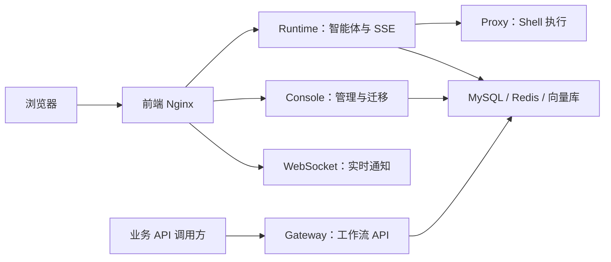

# 打包构建与部署

本页说明构建产物、服务分工和部署顺序。完整环境变量、Nginx 路由和多节点方案维护在源码仓库的 `docker/README.md`；共享存储与文件同步维护在 `docker/shared-storage.md`。

## 环境要求

| 依赖 | 版本 | 用途 |
| --- | --- | --- |
| JDK | 21 | 后端编译与运行 |
| Maven | 3.8+ | 后端构建 |
| Node.js | ^20.19.0 或 >=22.12.0 | 前端构建 |
| pnpm | 9+ | 前端包管理 |
| MySQL | 8.0+ | 业务与会话状态 |
| Redis | 7+ | 缓存、锁和配置广播 |
| PostgreSQL + pgvector | 16 | 选择 pgvector 时的向量库 |
| Docker / Compose | 20.10+ / v2+ | 容器部署 |

## 服务与构建产物

平台按职责运行独立服务，前端由 Nginx 托管：

| Maven 模块 | 职责 | 常用端口 / 启用条件 |
| --- | --- | --- |
| `GMD-FAQ-RUNNER-CONSOLE` | 配置管理、权限、数据库迁移 | 3060 |
| `GMD-FAQ-RUNNER-RUNTIME` | 智能体执行、AG-UI 流式接口 | 3061 |
| `GMD-FAQ-RUNNER-PROXY` | Shell 执行代理 | 3062，需要代码执行时 |
| `GMD-FAQ-RUNNER-WEBSOCKET` | 实时通知 | 3064 |
| `GMD-FAQ-RUNNER-GATEWAY` | 将工作流发布为 HTTP API | 应用动态端口，Linux host 网络 |
| `GMD-FAQ-RUNNER-FILE` | 技能与会话工作区快照同步 | 仅多节点本地存储模式 |



### 后端构建

在仓库根目录构建全部后端模块，或选择需要的 Runner：

```bash
mvn -DskipTests package
# 仅构建 console 及其依赖
mvn -pl GMD-FAQ-RUNNER-CONSOLE -am -DskipTests package
```

其他服务替换 `-pl` 模块名即可。可执行 JAR 位于各 Runner 的 `target/`，例如 `GMD-FAQ-RUNNER-RUNTIME/target/GMD-FAQ-RUNNER-RUNTIME-1.0-SNAPSHOT.jar`。

手动部署时，根据各 Runner 的配置文件准备数据库、Redis、服务地址及存储目录，再启动对应 JAR。开发环境配置模板与启动类见根目录 `README.md`。源码中的 UI 静态资源 Maven 打包定义不在默认模块构建链中，常规后端构建不会自动生成前端。

### 前端构建

```bash
cd ui
pnpm install --frozen-lockfile
pnpm build:main
pnpm build:doc
```

| 命令 | 产物 | 入口 |
| --- | --- | --- |
| `pnpm build:main` | `ui/dist-main/` | `index.html` |
| `pnpm build:doc` | `ui/dist-doc/` | `doc.html` |
| `pnpm build` | `ui/dist/` | 主应用和文档一起构建 |

以上构建命令均包含类型检查。文档源文件位于 `ui/src/doc/content/`，单独修改手册可只构建 doc 应用。

Docker 的前端镜像会构建主应用和文档，分别部署到 `/web/` 与 `/web/doc/`。手动托管时复用 `docker/nginx/nginx.conf` 的路由规则，保留 Runtime、WebSocket 与 Console 的独立代理；AG-UI 使用 SSE，代理需要关闭缓冲并允许长连接。访问主应用为 `/web/`，文档为 `/web/doc/doc.html`。

### 源码交付

在仓库根目录执行 `python scripts/export-source.py`（Python 3.9+ 和 Git），生成 `output/gmd-faq-source-<时间>.zip`。导出使用当前工作区内容，包含未提交修改，不包含 Git 历史、本地连接配置、缓存和运行数据；部署模板与全部数据库迁移保留在包中。

源码包须保留许可文件。网站构建目录中的 `licenses/` 和后端 JAR 中的 `META-INF/LICENSE` 随软件一并交付。品牌文案集中在 `ui/src/config/brand.ts`；存量数据目录及历史迁移应按部署升级要求维护。

## 数据库初始化与升级

仅新建数据库时执行 V1 基线：

```bash
mysql -u root -p -e "CREATE DATABASE gmd_faq_server DEFAULT CHARACTER SET utf8mb4 COLLATE utf8mb4_general_ci;"
mysql -u root -p gmd_faq_server < sql/db_init.sql
```

单机 Compose 的 MySQL 容器在首次初始化数据目录时自动导入基线。已有数据目录不会再次导入，不能用重新导入基线替代版本升级。

`sql/db_init.sql` 是 V1，最新结构由 V1 和全部后续迁移共同组成。Console 启动时自动执行 `GMD-FAQ-RUNNER-CONSOLE/src/main/resources/db/migration/` 中的 V2 及之后脚本；`sql/incremental/` 不作为部署或升级入口。

已应用迁移不能修改。升级时先让 Console 完成迁移，检查日志和 `flyway_schema_history`，再启动依赖新结构的 Runtime / Gateway。

## 单机 Docker 部署

在仓库根目录进入 `docker/`：

```bash
cd docker
# 仅首次且 .env 不存在时复制，再编辑端口、密码与资源预算
cp .env.simple .env
docker compose -f docker-compose-simple.yml up -d --build
docker compose -f docker-compose-simple.yml ps
docker compose -f docker-compose-simple.yml logs --tail 100 gmd-faq-console
```

已存在 `.env` 时直接使用 Compose，保留本机定制配置。`start-*.sh` 会用角色模板覆盖 `.env`；修改源码后启动须带 `--build`。

单机默认 9 个容器：MySQL、Redis、pgvector，Console、Runtime、Proxy、Gateway、WebSocket，以及前端 Nginx；无需 File 服务。访问 `http://127.0.0.1/web/`，端口以 `.env` 中的 `FRONTEND_PORT` 为准，默认账号为 `admin / Admin@123.com`。

重建 Console、Runtime 或 Gateway 后执行：

```bash
docker compose -f docker-compose-simple.yml restart gmd-faq-frontend
```

Nginx 需要重新解析容器 upstream 地址，否则可能返回 502。Windows / macOS Docker Desktop 可用于主流程联调，Gateway 的 host 网络需在 Linux Docker Engine 验证。

## 多节点部署

| 节点角色 | 编排文件 | 说明 |
| --- | --- | --- |
| 中间件 | `docker-compose-middleware.yml` | MySQL、Redis、向量库，也可替换为外部服务 |
| 控制台 | `docker-compose-console.yml` | Console、WebSocket、前端 |
| 执行节点 | `docker-compose-execute.yml` | Runtime、Proxy、Gateway；本地存储时增加 File |

每台服务器准备独立 `.env`，填写中间件地址、服务地址、数据目录和心跳标识。同一执行主机上的服务使用同一节点 ID，不同主机不能重复。

共享存储使用 `GMD_FAQ_STORAGE_MODE=shared`，各主机挂载同一个 NFSv4 目录。本地存储使用 `local`，启动执行节点时同时带 `--profile local-storage`；File 服务负责快照同步，本地同步有延迟，不能当作实时共享文件系统。

多 Runtime 节点需由部署方维护 Nginx upstream，并按 `X-GMD-FAQ-Thread-Id` 一致性 Hash 路由。该请求头须与请求体的 `threadId` 一致。数据库中可恢复的会话状态不代表运行中的 Agent、SSE 或外部工具可以自动迁移；上下线节点时先排空活动请求。

## AgentScope 2.0 升级

从 1.x 升级到 2.0.4 前备份数据库和数据目录，并等待活动运行结束：

1. 更新并启动 Console，确认 Flyway V28 成功，为状态表增加版本列。
2. 更新 Runtime；Gateway 中的工作流智能体执行依赖 Engine，也同步重建。
3. 更新前端并重启 Nginx，检查服务日志和访问入口。
4. 用正式会话验证多轮记忆、审批暂停/允许/拒绝、计划更新、图片与文件下载。

旧会话首次读取时自动转换，保留原消息、待确认工具和计划。新计划使用任务清单；记忆压缩只保留四项摘要配置。操作变化见 [智能体管理](#/agent) 与 [对话界面](#/chat)。

## 验证与排障

文档检查从仓库根目录执行：

```bash
node scripts/validate-docs-links.mjs
node scripts/validate-docs-mermaid.mjs
pnpm -C ui build:doc
```

后端、主应用和聊天回归命令统一维护在根目录 `README.md`。真实接口验证先登录获取 token，再携带 `Authorization: Bearer ...`；构建成功之后，还需检查对应服务日志和实际业务行为。

| 现象 | 检查方向 |
| --- | --- |
| 端口被占用 | `.env` 的宿主机端口和主机已有服务 |
| 容器 OOM / 退出 | Docker 可用内存、各服务容器预算、启动日志 |
| 前端 502 | 后端是否启动；重建后端后是否重启前端 |
| Flyway checksum mismatch | 恢复原迁移，通过新版本脚本追加变更 |
| 状态表缺少 `version` | Console 是否已完成 V28，Runtime 是否连接同一库 |
| 图片或文件访问失败 | 会话归属、数据路径、工作空间容量及当前节点的存储状态 |
