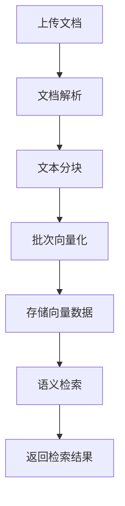

# 知识库管理

知识库管理是智能体的"私有记忆与专业智库"，通过先进的 RAG（检索增强生成）技术，将企业的私有文档、数据库、业务知识统一构建为可检索、可推理的结构化知识体系，让智能体在通用能力基础上具备企业级专业知识。

## 功能概述

- 支持五种知识库类型：百炼、Dify、RagFlow、知识图谱、本地
- 本地知识库和知识图谱可直接选择平台模型管理中已启用的模型，统一维护地址与认证
- 支持自动文档分块、向量化、语义检索全流程
- 支持多种 RAG 模式配置
- 提供连接配置、端点配置、检索配置、重排配置等完整参数
- 自动健康检查与同步状态监控
- 支持元数据过滤和查询重写

## 核心概念

### 知识库类型

| 类型 | 说明 | 适用场景 |
|------|------|----------|
| **本地（LOCAL）** | 平台内置的 RAG 引擎，文档存储在本地，自动完成分块、向量化、检索 | 希望完全掌控数据隐私和检索流程的场景 |
| **百炼（BAILIAN）** | 阿里云百炼平台知识库 | 已有百炼平台知识库 |
| **Dify** | Dify 平台知识库 | 已有 Dify 知识库 |
| **RagFlow** | RagFlow 平台知识库 | 已有 RagFlow 知识库 |
| **知识图谱** | 文档解析、图谱与向量检索，保留实体、关系及来源 | 需要管理文档、浏览实体关系并关联智能体 |

### RAG 模式

| 模式 | 说明 |
|------|------|
| **GENERIC** | 每轮用户提问首次推理前自动检索一次，适合需要直接使用知识库回答的场景 |
| **AGENTIC** | Agent 使用工具自主决定何时检索知识，适合需要灵活决策的复杂场景 |

> 注意：本地知识库节点仅生成 RAG 相关的查询接口，不直接提供同步接口。

### 配置区域

知识库配置包含以下区域：

| 区域 | 说明 | 本地知识库 |
|------|------|-----------|
| **连接配置** | 嵌入模型提供商、服务地址、维度等核心参数 | 支持 |
| **端点配置** | 检索和查询的端点地址 | 不支持（本地自动管理） |
| **检索配置** | 分块策略、Top-K、相似度阈值等 | 支持 |
| **重排配置** | 结果重排序参数 | 不支持 |
| **查询重写配置** | 查询改写和优化参数 | — |
| **元数据过滤** | 基于元数据的条件过滤 | — |
| **HTTP 配置** | 自定义 HTTP 请求参数 | — |

## 本地知识库详解

本地知识库是平台内置的 RAG 引擎。先在[模型管理](#/model)中添加向量模型，设置实际输出维度，再在知识库中选择；平台自动完成文档解析、分块、向量化和语义检索。

### 本地知识库工作流程

### 嵌入模型提供商

平台向量模型支持 OpenAI 兼容接口、百炼 DashScope、Ollama 和 OrcaRouter。知识库只保存模型引用，调用时由后端读取当前供应商地址及认证，不在知识库中重复保存模型密钥。

已有手动配置继续可用，旧地址与模型默认值如下：

| 提供商 | 默认模型 | 默认服务地址 | 是否需要 API Key |
|--------|---------|-------------|-----------------|
| **Ollama** | `qwen3-embedding:4b` | `http://localhost:11434/api/embed` | 否 |
| **Bailian** | `text-embedding-v4` | `https://dashscope.aliyuncs.com/compatible-mode/v1/embeddings` | 是 |

已有手动配置可以切换到平台模型；有文档时须先清空文档，再保存模型选择并重新上传构建。

### 连接配置参数说明

#### 平台向量模型

从“向量模型”中选择当前租户已启用的模型，维度自动带出。列表只显示用途与接口兼容的模型；没有候选时，先到模型管理中配置向量类型及输出维度。模型停用、删除、供应商停用或跨租户引用会被拒绝。供应商密钥更新在下次调用时读取。

本地存储支持 64、128、256、512、768、1024、1536、2048、2560、3072 维；其他维度可由知识图谱服务按其存储后端能力使用。平台不会截断或补齐模型实际返回的向量。

同维度的不同模型也不能混用。已有文档时禁止更换模型；模型管理中修改模型编号、供应商、地址或维度后，原索引不能继续使用，须清空文档并重新保存、重新构建。知识库创建后的维度固定；需要不同维度时新建知识库。

#### 原有手动配置：模型提供商
- **说明**：选择嵌入模型的提供商，支持 Ollama（本地/自托管）和 Bailian（阿里云百炼 DashScope）
- **默认值**：Ollama
- **提示**：切换提供商会自动更新服务地址和模型默认值

#### API Key（仅 Bailian）
- **说明**：Bailian 平台的 API Key，Ollama 本地部署无需此项
- **环境变量支持**：支持 `${ENV_VAR}` 语法引用系统环境变量，例如 `${DASHSCOPE_API_KEY}`
- **必填**：选择 Bailian 时必填

#### 服务地址
- **说明**：嵌入模型的 API 服务地址（完整 URL，含路径）
- **Ollama 默认**：`http://localhost:11434/api/embed`
- **Bailian 默认**：`https://dashscope.aliyuncs.com/compatible-mode/v1/embeddings`
- **操作**：可手动修改，点击"重置默认"恢复当前提供商的默认地址

#### 嵌入模型
- **说明**：用于文本向量化的模型名称
- **Ollama 默认**：`qwen3-embedding:4b`
- **Bailian 默认**：`text-embedding-v4`
- **操作**：可手动修改，点击"重置默认"恢复当前提供商的默认模型

#### 向量化维度
- **说明**：输出向量的维度数，决定了向量的表达能力与存储成本
- **平台模型**：自动采用模型管理中设置的输出维度，支持 1–65536，必须与接口实际返回一致
- **原有手动配置**：保留原来的维度设置
- **重要提示**：创建后不可修改。模型返回数量或维度不匹配时，向量化会明确失败
- **维度选择建议**：

| 维度 | 适用场景 |
|------|---------|
| 64-256 | 简单关键词匹配、分类任务 |
| 512-768 | 中等复杂度语义检索 |
| 1024 | 通用场景，推荐默认值 |
| 2048-2560 | 高精度专业领域检索 |

#### 响应缓冲大小
- **说明**：WebClient 内存缓冲区大小，用于接收嵌入 API 的响应
- **默认值**：50 MB
- **范围**：1-512 MB
- **提示**：大数据量时（批次大、维度高）可适当增大，避免内存溢出

#### 单批次最大文本数
- **说明**：单次请求发送的最大文本数量
- **默认值**：10
- **范围**：1-100
- **提示**：超出批次上限的文本会自动拆分为多批次请求。Bailian 和 Ollama 均有批次大小限制，默认 10 为安全值

### 检索配置参数说明

#### 分块分隔符
- **说明**：文档分块的优先级分隔符，多个分隔符用英文逗号分隔
- **支持转义**：`\n`（换行）、`\t`（制表符）、`\r`（回车）
- **示例**：`\n\n,^\|,\n` 表示优先按空行分块，其次按管道符开头、再次按单换行分块
- **默认**：留空则按字符数分块

#### 最大块长度
- **说明**：每个文本块的最大字符数
- **默认值**：512
- **范围**：128 - 8192

#### 分块重叠
- **说明**：相邻文本块之间的重叠字符数，用于保持语义连贯性
- **默认值**：64
- **范围**：0 - 1024

#### Top K
- **说明**：检索时返回的最相关文本块数量
- **默认值**：5
- **范围**：1 - 100

#### 相似度阈值
- **说明**：向量相似度的最低入围分数，低于此值的结果将被过滤
- **默认值**：0.5
- **范围**：0 - 1（步长 0.1）

## 操作指南

### 创建本地知识库

1. 在知识库管理页面点击 **添加新知识库** 卡片
2. 类型选择 **本地**
3. 选择 RAG 模式
4. 填写基本信息：名称、描述
5. 在 **连接配置** 中：
   - 从平台模型管理中选择已启用的向量模型
   - 核对自动带出的输出维度（创建后不可更改）
   - 根据需要调整缓冲大小和批次上限
6. 在 **检索配置** 中：
   - 设置分块分隔符、块长度、重叠量
   - 设置 Top K 和相似度阈值
7. 点击确定提交

### 上传文档

创建本地知识库后，进入「我的知识库」页面，点击知识库卡片上的 **文档** 按钮进入文档管理页面。

文档管理页面以全屏弹窗形式打开，支持以下操作：

- **上传文档**：支持拖拽和点击上传，文本文件自动入库
- **查看文档状态**：展示每个文档的解析状态、分块数量、向量化进度
- **删除文档**：删除文档及其向量数据

关于文档上传、解析、分块等操作的详细说明，请参考 [知识库文档管理](#/knowledge) 章节。

### 启用/禁用

点击卡片右上角菜单 → **启用/禁用**，切换知识库的启用状态。

- 禁用的知识库不会参与智能体的知识检索
- 若知识库正在被智能体引用，禁用时系统会弹出二次确认提示

:::warning
禁用被智能体引用的知识库时，系统会显示「该知识库正在被 [xxx] 智能体引用，禁用后可能会影响上述智能体的正常使用」。
:::

### 查看详情

点击卡片右上角菜单 → **查看**，查看完整配置信息，详情弹窗展示以下字段：

| 字段 | 说明 |
|------|------|
| **关联智能体** | 引用此知识库的智能体列表 |
| **名称** | 知识库名称 |
| **类型** | 本地 / 百炼 / Dify / RagFlow / 知识图谱 |
| **描述** | 知识库说明 |
| **连接配置** | 嵌入模型提供商、服务地址、维度等（JSON 格式） |
| **端点配置** | 检索和查询的端点地址（JSON 格式） |
| **检索配置** | 分块策略、Top-K、相似度阈值等（JSON 格式） |
| **重排序配置** | 结果重排序参数（JSON 格式） |
| **查询重写配置** | 查询改写和优化参数（JSON 格式） |
| **元数据过滤** | 基于元数据的条件过滤（JSON 格式） |
| **HTTP 配置** | 自定义 HTTP 请求参数（JSON 格式） |
| **健康状态** | 当前健康检查结果 |
| **最后同步时间** | 最近一次同步操作时间 |

### 编辑配置

点击卡片右上角菜单 → **编辑**，修改知识库配置。

- 向量化维度在编辑状态下不可修改（灰显），其余配置均可调整
- 修改知识库配置后，关联智能体将自动重新注册

### 删除知识库

点击卡片右上角菜单 → **删除**。

- 若知识库正在被智能体引用，系统会弹出二次确认框，显示引用的智能体名称
- 若无引用，弹出常规删除确认框
- 删除操作不可恢复

:::warning
删除本地知识库会同时清理数据库记录和向量数据，请确认不再需要后再执行。
:::

### 搜索与筛选

- **类型筛选**：页面顶部分段控制器切换知识库类型（百炼 / Dify / RagFlow / 知识图谱 / 本地）
- **名称搜索**：输入关键词后回车搜索

## 在智能体中使用

在智能体配置的「知识库与 MCP」步骤中：

1. 在 **知识库** 区域，按类型折叠面板浏览
2. 勾选需要关联的知识库（Checkbox 多选）
3. 每个智能体可关联多个不同类型的知识库

## 配置说明

### 百炼知识库连接配置

- **API Key**：百炼平台 API Key
- **知识库 ID**：百炼平台中的知识库标识

### Dify 知识库连接配置

- **API Key**：Dify 平台 API Key
- **Base URL**：Dify 服务地址

### RagFlow 知识库连接配置

- **API Key**：RagFlow 平台 API Key
- **Base URL**：RagFlow 服务地址
- **知识库 ID**：RagFlow 中的知识库标识

### 知识图谱

知识图谱支持文档上传、解析、实体关系抽取与索引，可在平台内管理文档、浏览图谱、分配知识库授权并关联智能体。

平台已集成 LightRAG 知识图谱后端与 MinerU 文档解析后端，通过统一部署提供服务。PDF 可使用 MinerU 完成 OCR、表格和公式解析，再进入图谱与向量索引；图谱抽取、图片理解和向量化仍使用配置的模型。文档管理和图谱浏览沿用本平台入口，无需另外访问 LightRAG 或 MinerU 页面。本平台使用 [LightRAG](https://github.com/HKUDS/LightRAG) 和 [MinerU](https://github.com/opendatalab/MinerU) 提供上述能力。

1. 在知识库管理中选择 **知识图谱**，默认使用 **内置知识图谱**，填写名称即可，无需填写服务地址与 API 密钥。在 **模型配置** 中选择平台模型并保存；也可保留服务原配置。已有第三方服务可点击 **连接第三方服务**，展开地址和密钥；点击 **使用内置服务** 可切回。
2. 点击知识库卡片上的 **管理**，进入 **文档管理**，上传文档、查看解析与实体抽取进度、重试失败任务。切换 **知识图谱** 可搜索实体、浏览图谱并查看节点和关系详情。
3. 打开 **检索测试**，输入问题并检查文档片段、图谱上下文、来源和相关图片。
4. 在[智能体配置](#/agent)的知识库区域中添加该知识库。智能体的 RAG 模式决定每轮首次推理前自动检索，或由模型按需检索。

管理入口要求具有知识库编辑权限，且当前账号可管理该资源；部门和平台资产由相应负责人、指定维护人或管理员管理，只有查看或使用授权的成员不能管理文档。图谱属性只读。页面加载失败时会显示连接提示，可检查服务配置后点击 **刷新**。

| 配置 | 说明 |
| --- | --- |
| 连接方式 | 默认内置服务，地址和认证由管理员统一部署；原有第三方连接继续保留 |
| 服务地址 | 仅第三方连接需要填写；支持带反向代理路径前缀 |
| API 密钥 | 仅第三方连接需要填写；对应第三方服务的 API 密钥，未启用此认证时可留空 |
| 检索模式 | `mix` 图谱与向量、`hybrid` 实体与关系、`local` 实体、`global` 关系、`naive` 向量；默认 `mix` |
| 返回片段数（Top K） | 默认 20，范围 1–1000；智能体和工作流可覆盖 |
| 图谱检索数量 | 默认 60，范围 1–1000；独立于返回片段数 |
| Token 上限 | 实体、关系与总上下文预算，默认分别为 6000、8000、30000，由知识图谱服务执行预算控制 |
| 启用重排 | 默认开启，可选平台重排模型或使用知识图谱服务原配置 |
| 单次请求超时 | 默认 180 秒，范围 1–600 秒 |
| 最大重试次数 | 默认 0，最多 3；仅连接失败、超时、HTTP 429 和 5xx 可重试，可能增加检索模型用量 |

有图谱结果时，检索测试会在文档片段之外单独展示一条 **知识图谱** 上下文，包含实体、关系和引用；因此结果总数可能比 Top K 多一条。图谱与来源也会进入智能体的知识上下文。知识图谱未提供统一相关度分数，界面显示“相关度未提供”，不应用平台的统一分数阈值；与其他类型混用时，阈值只对支持该参数的知识库生效。

内置图谱的一份工作区数据绑定一个平台知识库；其他成员通过该知识库的共享与授权使用，不能另建配置绕过原知识库的权限。需要多个隔离知识库时，为各工作区部署独立实例，并点击 **连接第三方服务** 填写各自地址。平台对配置的授权不能进一步拆分同一工作区里的文档权限。

**平台模型选择**：默认文本模型用于未单独指定的抽取、关键词、回答角色；可分别指定实体关系抽取与摘要、检索关键词、服务回答、图片理解、向量和重排模型。图片理解须选择图像类型模型，不会自动使用纯文本模型。支持 OpenAI 兼容、百炼、Ollama 等接口；Responses 与不兼容供应商不会出现在候选列表。平台检索使用 `/query/data`，最终回答仍由智能体生成，所选服务回答模型用于 LightRAG 自身回答接口。

**同步与生效**：编辑保存会同步模型配置，也可点击“同步已保存的模型配置”。同步后需要重启 LightRAG 的全部进程；未生效时文档处理和平台检索会明确提示。首次创建先保存，编辑后同步；首次使用前也会检查并同步。已有向量数据更换向量模型时，先停止服务，使用 `lightrag-rebuild-vdb` 重建，再重启。即使新旧模型维度相同也须重建。平台不会自动清空已有文档或索引。

平台模型管理的密钥或参数更新后，可重新同步并重启；未重启前不会静默继续使用旧配置。清空平台模型选择后保存并同步、重启，恢复服务环境中的配置。一个工作区的模型同步仅允许绑定一个平台知识库，绑定冲突会拒绝覆盖。

图谱检索的关键词提取、嵌入和重排等用量不属于平台主模型用量。内置服务的密钥由服务端读取，知识库配置中不保存或返回该密钥；第三方管理页沿用已保存的连接配置。文档上传、删除、重试和清空会直接操作对应工作区。删除平台配置只解除连接，不删除工作区中的文档。

智能体在使用证据的段落末尾附上来源标记。查询和回答生成期间不展示引用角标或文档卡片；整轮回答完成后，界面将有效标记显示为数字角标，并在文末仅展示实际引用的同编号文档卡片。点击角标可定位、展开对应卡片，查看文件路径、所属知识库和原文片段。同一文档合并引用，不同知识库的同名文档分别编号；无效来源标记不会生成角标。只参与图谱检索而没有返回原文片段的来源会单独说明。旧回答没有有效段落标记时不展示检索文档卡片。关闭工具调用详情不影响最终引用展示，正式会话的引用随聊天记录保存。

实体和关系分别使用该条记录的来源文件，支持图谱返回的多文件来源；向量片段的引用列表只对应片段本身，不能替代图谱来源。来源缺失时不借用其他命中文档。查询包含产品型号且图谱已明确其来源文件时，其他文件中未提及该型号的向量片段不作为本次证据。型号查询的图片必须能通过图片描述或型号与图片的直接图谱关系核实；平台从单次响应的最多 20 张候选中筛选，再按配置的图片数量限制展示，候选仍受服务端容量限制，不额外检索或调用图片分析模型。

自动检索和按需检索期间均显示动态查询提示，关闭工具详情仍可查看，具体展示见[对话界面](#/chat)。

知识图谱服务会从本次命中的片段、实体和关系的来源片段定位已有图片，图片实体未进入上下文时仍可沿产品实体和关系找到原图；图谱来源优先于宽泛的向量命中。数量可设置为 1–20 张，默认 3 张；单张不超过 5 MiB，总量不超过 8 MiB，因此实际数量可能少于配置值。图片定位不重复检索、不再次调用图片分析模型。服务缺少图片、未保存图片索引或版本不支持图片返回时，文字和引用仍可正常使用。知识图谱服务与平台需要一同升级才能按新数量返回图片。

知识库图片复用[对话图片展示和预览](#/chat)机制：图片保存到当前会话工作空间，供支持图片输入的模型继续分析。查询和回答生成期间不提前展示候选图片；整轮回答完成后，只有正文明确引用的图片显示在引用处，其余候选不单独展示。图片无效或保存失败时，其余证据仍可使用。

检索模式、Top K、图谱数量、Token 预算和重排由已保存的配置控制；智能体只组织查询内容，按需模式下证据不足可补充检索，不额外调用模型决定这些参数。每个智能体可以在 **设计 → 知识库 → 知识库调用策略** 中独立覆盖，未覆盖的参数继承各知识库默认值。共享知识库的连接和数据不受智能体覆盖影响，检索测试仍使用知识库默认配置。

#### 每个智能体的调用策略

关联知识库后，知识库卡片会先显示当前策略摘要，点击 **配置策略** 展开设置。预设和常用设置放在前面，高级参数按用途分组收纳：

| 位置 | 配置内容 |
| --- | --- |
| 选择预设 | 速度优先（推荐）、图谱增强、继承默认；点击填入草稿，手动微调后显示“自定义” |
| 常用设置 | 自动或按需调用、知识图谱检索模式、Top K、严格依据证据、相关图片开关 |
| 调用与等待预算 | 超时、并发、知识图谱重试；自动模式显示历史问题轮数，按需模式显示每轮检索次数；其他类型知识库显示相关度阈值 |
| 知识图谱高级检索 | 总 Token、重排；图谱模式额外显示图谱数量及实体、关系 Token；切换为向量模式保留原图谱参数 |
| 证据与图片额度 | 总证据与单片段字符上限、图片开启时的数量上限 |
| 查看知识库默认值 | 各关联知识库的原始检索参数，便于核对继承值 |

高级分组收起时仍显示预算摘要。展开、收起不会改动策略；选择“继承默认”会清除当前智能体的策略覆盖。检索参数留空继承各知识库，等待与证据预算使用平台默认值。修改后点击设计页 **保存**，正式对话和预览均使用服务端保存的策略；子智能体使用自己的策略。旧配置的 Top K、阈值和调用方式保留，新增的等待、次数和证据预算使用表中默认值。

| 配置 | 作用与默认值 |
| --- | --- |
| 调用方式 | GENERIC 每轮首次推理前检索一次，不增加决策模型调用；AGENTIC 由模型按需检索，未显式配置时继承首个知识库的调用方式 |
| 每轮最多检索次数 | AGENTIC 默认 3，范围 1–8；同批并发调用共享额度，失败也计次，暂停续跑保留额度，新用户问题重置；达到上限后隐藏检索工具并拒绝额外调用 |
| 单次检索总超时 | 默认 60 秒，范围 1–180 秒；包括多个知识库排队、请求和重试，取消等待后向模型返回失败，不表示远端模型任务一定已停止 |
| 同时检索的知识库数 | 默认 4，范围 1–4；数量越高瞬时负载越高 |
| Top K / 阈值 | 留空继承各知识库，填写后覆盖本智能体的所有关联知识库；知识图谱忽略统一分数阈值 |
| 知识图谱检索模式 | `naive` 向量、`local` 实体、`global` 关系、`hybrid` 实体与关系、`mix` 图谱加向量；可清空恢复继承 |
| 知识图谱数量 / Token / 重排 | 可逐项覆盖或继承；包括实体 Token、关系 Token、总上下文 Token 和重排。重排仍需远端配置模型 |
| 知识图谱重试 | 留空继承知识库，0–3 次；同时受本次总超时约束，低延迟场景建议 0 |
| 总证据 / 单片段字符上限 | 默认 30000 / 6000，范围分别为 2000–120000 / 500–20000；多个知识库单次返回合计，按顺序去重、截断并标记，引用仍保留；与知识图谱 Token 预算同时生效 |
| 自动检索携带前几轮问题 | 默认 0，范围 0–4；只拼接历史用户问题，每条最多 1000 字符，不调用查询改写模型，适合“它的参数呢”等追问 |
| 图片 / 数量 | 默认开启、每次最多 3 张；可关闭或自定义为 1–20 张，多个知识库合计；速度优先建议 2 张。知识图谱同时受单张 5 MiB、合计 8 MiB 的容量限制 |
| 严格依据检索证据回答 | 默认开启；要求来源、区分原文与推断、证据不足或失败时说明，不补造具体参数；关闭后允许通用知识与检索内容分开回答。资料中的指令始终不能覆盖系统规则 |

#### 推荐：速度与证据均衡

点击 **速度优先（推荐）** 预设会在当前智能体草稿中填入以下参数，保存后生效，不自动改变其他智能体。

| 参数 | 推荐值 |
| --- | --- |
| 调用方式 / 次数 | GENERIC，每轮 1 次 |
| 知识图谱检索模式 | naive（向量检索，避开图谱关键词提取） |
| Top K / 重排 | 6 / 关闭 |
| 总超时 / 重试 / 并发知识库 | 20 秒 / 0 / 2 |
| 总证据 / 单片段 | 18000 / 4000 字符 |
| 知识图谱总 Token | 6000 |
| 图谱数量 / 实体 Token / 关系 Token | 20 / 1500 / 2000，切换到图谱模式时使用 |
| 历史问题 / 图片 | 前 1 轮 / 最多 2 张 |
| 严格依据证据 | 开启 |

涉及设备、部件之间的关系或跨文档分析时，可点击 **图谱增强** 预设使用相同预算的 `mix`、30 秒总超时；也可单独选 `local`。如果 `naive` 漏检，先用实际问题比较图谱模式，再决定是否增大预算。超时上限只限制等待，不能保证在该时限内检索成功。来源和回答约束有助于减少无依据回答，不能保证零错误，资料本身仍需审核。图片编码、传输和视觉输入仍有开销。

服务地址应从 Runtime 所在环境可达。容器网络和升级顺序由管理员参照仓库中的 Docker 部署指南配置。

### 元数据过滤

通过添加元数据条件，可以在检索时精确过滤文档：

- **字段名**：元数据的字段名
- **比较操作符**：`=`、`!=`、`>`、`<` 等
- **值**：过滤条件的值

## 常见问题

### 如何选择嵌入模型提供商？

- **Ollama**：适合内网环境、有自建 GPU 服务器、对数据隐私要求高的场景。无需 API Key，完全本地运行
- **Bailian**：适合已有阿里云百炼账号、希望使用云端高性能嵌入模型的场景。需要 API Key 和网络访问

### 如何选择向量化维度？

- 维度越高，向量表达能力越强，但存储和计算成本也越高
- 1024 是通用场景的最佳平衡点，能满足绝大多数语义检索需求
- 维度一旦选定不可更改（需重建知识库），请谨慎选择

### 知识库健康检查失败？

- 检查 API Key 是否正确
- 检查服务地址是否可达
- 检查网络防火墙设置
- 对于 Ollama，确认服务是否已启动：`ollama serve`

### 检索结果不准确？

- 调整 Top-K 参数（增大返回更多结果）
- 调整相似度阈值（降低阈值放宽匹配）
- 优化分块策略：减小块长度获更精细匹配，增大重叠量保持语义连贯
- 调整分块分隔符使其更贴合文档结构

### 向量化报错"批次大小无效"？

- 减小"单批次最大文本数"参数，Bailian 限制单批次不超过 10 条
- 平台会自动将大批次拆分为多批次请求，确保参数在安全范围内即可

### Ollama 模型列表为空？

- 确认 Ollama 服务已启动
- 运行 `ollama pull qwen3-embedding:4b` 拉取嵌入模型
- 运行 `ollama list` 查看已安装的模型

### 本地知识库和第三方知识库如何选择？

- **本地知识库**：适合对数据隐私要求高、希望完全掌控检索流程的场景
- **百炼/Dify/RagFlow**：适合已有第三方平台知识库、希望复用的场景
- **知识图谱**：适合需要文档解析、图谱浏览与关系检索的场景
- 本地知识库支持更精细的配置（嵌入模型、分块策略、相似度阈值等）
- 第三方知识库通过 API 对接，配置相对简单

### 删除知识库会影响已关联的智能体吗？

- 删除时系统会弹出二次确认框，显示引用的智能体名称
- 确认删除后，关联智能体将无法检索该知识库的内容
- 建议先在智能体配置中解除知识库关联，再执行删除

### 知识库健康状态显示异常？

- 健康状态由系统自动检查，包括连接可达性、API Key 有效性等
- 检查服务地址是否可达、API Key 是否正确
- 对于 Ollama，确认 `ollama serve` 已启动
- 可尝试重新编辑配置并保存，触发健康检查刷新

资源支持个人、部门和平台归属。空间切换、共享范围、维护资格和资产移交统一见 [常见问题](#/qa)。
